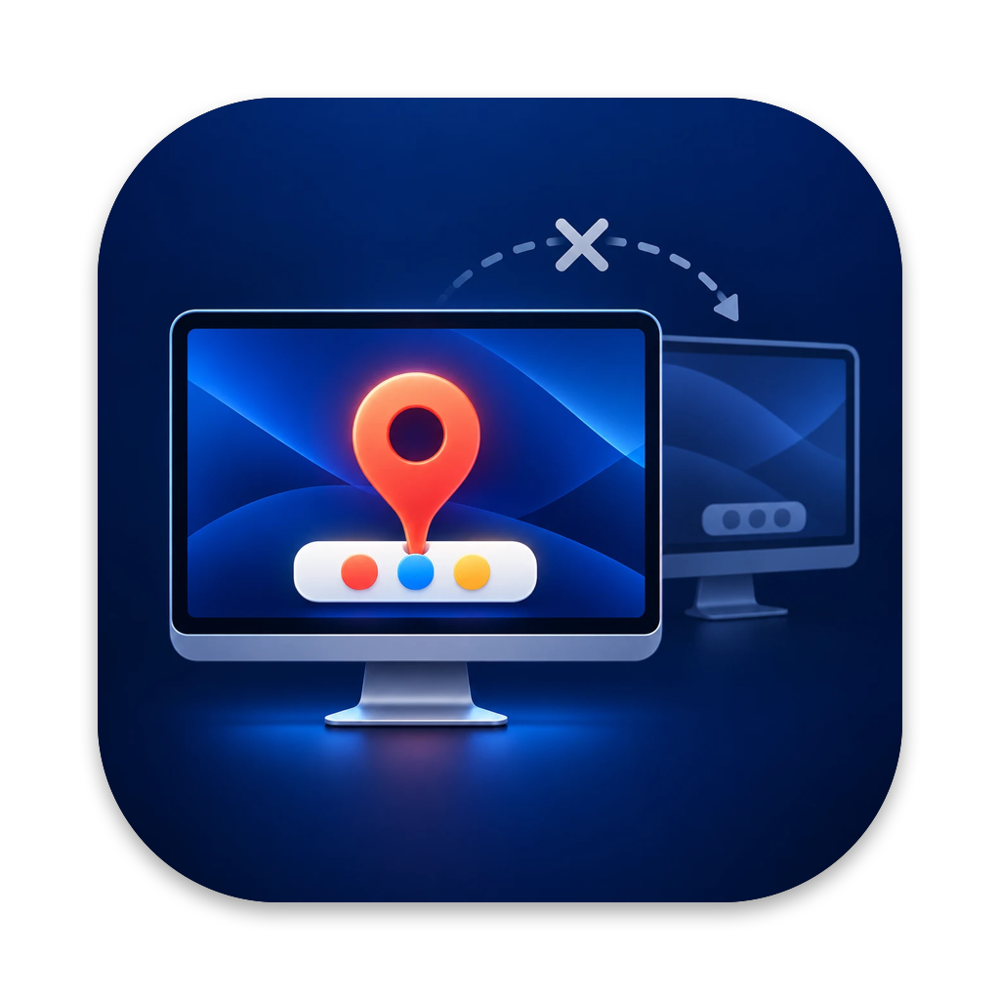

# DockPin

Keeps the macOS Dock on the main display. It stops the Dock from jumping to
another monitor and brings it back if it ended up there anyway.

About 2 MB of memory, 0% CPU when idle, no icon and no UI.

## Install

```sh
brew tap indapublic/dockpin https://github.com/indapublic/dockpin
brew trust --formula indapublic/dockpin/dockpin   # Homebrew 7+ asks to trust third-party taps
brew install indapublic/dockpin/dockpin
brew services start dockpin
```

From a clone of this repository, `make install` does the same.

Then enable DockPin in System Settings > Privacy & Security > Accessibility.

## Commands

Run from a clone of this repository; `make help` prints the same list.

| Command | What it does |
| --- | --- |
| `make install` | Install from the Homebrew tap and start the service |
| `make update` | Upgrade to the latest release and restart the service |
| `make uninstall` | Stop the service and uninstall |
| `make start`, `make stop`, `make restart` | Control the service |
| `make status` | Show the service state and memory footprint |
| `make logs` | Follow the service log |
| `make` | Build `DockPin.app` |
| `make test` | Run the edge-logic tests |
| `make lint` | Run the clang static analyzer and shellcheck |
| `make release VERSION=x.y.z` | Build, sign and notarize, tag, publish the GitHub release and update the formula (needs the Developer ID, see `tools/release.sh`) |
| `make clean` | Remove build products |

Without a clone, the same is available through `brew upgrade dockpin`,
`brew uninstall dockpin` and `brew services start|stop|restart dockpin`.

Releases are universal builds signed with a Developer ID and notarized, so the
Accessibility permission survives updates. Builds from source (`--HEAD`,
`make`) are signed ad hoc, and macOS asks for the permission again after each
of them; DockPin removes the stale entry itself, so you only need to switch
it on.

After uninstalling, remove DockPin from System Settings > Privacy & Security >
Accessibility with the − button.

## How it works

The Dock moves to another display when the pointer pushes against that
display's Dock edge (the bottom one, or a side if the Dock is on the side).
DockPin drops mouse-move events inside a 4 pt band along that edge of every
non-main display. The cursor still moves normally, but the Dock never sees
the push. Parts of the edge that border another display are left alone, so
the cursor crosses over there as usual.

At startup and after display changes, a short-lived child process checks
where the Dock is and, if needed, brings it back to the main display by
briefly pushing the pointer against that display's edge.

The main display is the one marked as main in System Settings > Displays.

## License

MIT
